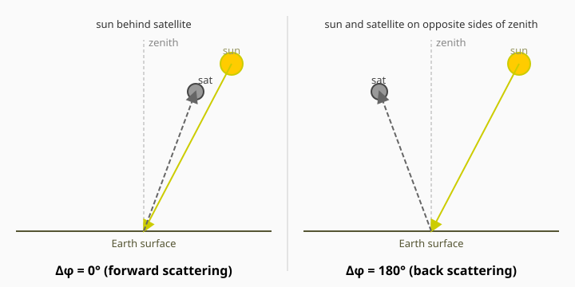

# Conventions

**For:** anyone cross-validating vSmartMOM against another RT code (VLIDORT,
DISORT, …) or importing Greek-coefficient / Stokes data from one.

**Next:** [Configure a Scene (step by step)](IO/ConfigurationGuide.md), [Vector RTE & Discretization (Concepts)](concepts/02_rt_theory.md), [Benchmarks](benchmarks.md).

Polarized radiative transfer codes have to commit to a specific set of sign,
phase-matrix, and angle conventions. Different lineages (vSmartMOM's
de Rooij/Hovenier-style code convention, Siewert–Mishchenko–VLIDORT,
Stamnes–DISORT, …) made different choices, and the
choices are largely interchangeable *as long as you stay inside one
convention*. The pain hits when you cross-validate two codes that quietly
follow different conventions.

This page first lays out **the conventions vSmartMOM uses internally**, then
shows **how they differ from VLIDORT** so you know exactly where to apply
sign flips when comparing or importing data.

If you only read one section, read **§4 — comparing against VLIDORT**.

---

## 1. Stokes vector and reference plane

vSmartMOM uses the **Stokes vector** ``(I, Q, U, V)`` defined with respect
to the **meridian plane**: the vertical plane containing the zenith
direction and the propagation direction. For a beam with propagation
direction ``\hat k``, let ``\hat\theta`` (in the meridian plane) and
``\hat\varphi`` (horizontal, perpendicular to it) be its spherical basis
vectors, and ``E_\varphi``, ``E_\theta`` the field components. Then

```math
I = |E_\varphi|^2 + |E_\theta|^2,\quad
Q = |E_\varphi|^2 - |E_\theta|^2,\quad
U = 2\,\mathrm{Re}(E_\varphi E_\theta^*),\quad
V = 2\,\mathrm{Im}(E_\varphi E_\theta^*).
```

So ``Q > 0`` means linear polarization **perpendicular** to the meridian
plane. These are the Q, U, V of the Mishchenko/VLIDORT convention with
opposite sign (§4.2). The definitions are verified in
`test/test_coxmunk_polarization.jl`: an independent electric-field
calculation reproduces vSmartMOM's own Rayleigh phase matrix only in this
basis, and VLIDORT's complex-index Cox–Munk kernel fixes the sign of V.
(Earlier versions of this page stated that ``Q > 0`` meant polarization
parallel to the meridian plane; the code has always used the convention
above.)

This is the **Hovenier–van der Mee–Domke convention** (Hovenier &
van der Mee 1983; Hovenier, van der Mee & Domke 2004). The vSmartMOM theory
papers print the Greek and generalized-spherical-function matrices in
Siewert's form (§2); relative to that form, with Siewert's (2000) and VLIDORT's
coefficient signs, the code's γ, ε, Q, U and V carry the opposite sign (§2, §4).

The polarization-type variants `Stokes_I`, `Stokes_IQ`, `Stokes_IQU`,
`Stokes_IQUV` simply truncate this vector — they don't change the
sign convention. (The RT solvers reject `Stokes_IQ`; it remains available
in StandaloneSS `ExactSSConfig` runs and the Scattering-level functions.)

---

## 2. Phase matrix and Greek coefficients

The single-scattering phase matrix in vSmartMOM is expanded in
generalized spherical functions following Siewert (1981, 2000) and de Rooij &
van der Stap (1984). Sanghavi & Stephens (2015, Eqs. 21–22) print the Greek
matrix and the generalized spherical-function matrix in Siewert's form, and
the vSmartMOM paper (Sanghavi et al. 2014) uses Siewert's (1982) matrices by
reference:

```
         ⎡ β_l   γ_l    0     0   ⎤                ⎡ P_l^m   0      0     0   ⎤
   B_l = ⎢ γ_l   α_l    0     0   ⎥ ,   Π_l^m ∝   ⎢  0    R_l^m  −T_l^m   0   ⎥
         ⎢  0     0    ζ_l  −ε_l ⎥                ⎢  0   −T_l^m   R_l^m   0   ⎥
         ⎣  0     0    ε_l   δ_l ⎦                ⎣  0      0      0   P_l^m ⎦
```

with ``α_l, β_l, γ_l, δ_l, ε_l, ζ_l ∈ ℝ`` (per Legendre order ``l``); this is
also the convention of VLIDORT and of Siewert's (2000) benchmark tables.

**How the code relates to the papers.** vSmartMOM's `construct_Π_matrix`
builds exactly the Π_l^m above. Its Stokes vector, however, is
``(I, -Q, -U, -V)`` relative to the Siewert/VLIDORT convention in which these
matrices are written (§4.2; this mapping is validated against VLIDORT 2.8.3). With ``D = \mathrm{diag}(1,-1,-1,-1)``
the Greek matrix transforms as ``B_l \to D B_l D``, which changes the sign of
the ``[1,2]/[2,1]`` elements and leaves the ``[3,4]/[4,3]`` elements unchanged.
`construct_B_matrix` (in
[`src/Scattering/mie_helper_functions.jl`](https://github.com/RemoteSensingTools/vSmartMOM.jl/blob/main/src/Scattering/mie_helper_functions.jl))
writes

```
              ⎡ β_l   γ_l    0     0   ⎤
   B_l,code = ⎢ γ_l   α_l    0     0   ⎥   with   γ_l(code) = −γ_l(Siewert),
              ⎢  0     0    ζ_l   ε_l ⎥          ε_l(code) = −ε_l(Siewert),
              ⎣  0     0   −ε_l   δ_l ⎦
```

so its ``[3,4]/[4,3]`` block is numerically the block above (``+ε_l(code)``
at ``[3,4]`` is Siewert's ``-ε_l``), and only γ differs as a matrix element.
The stored `GreekCoefs.γ` and `GreekCoefs.ϵ` (see
[`src/Scattering/types.jl`](https://github.com/RemoteSensingTools/vSmartMOM.jl/blob/main/src/Scattering/types.jl))
are therefore Siewert's coefficients with the opposite sign. Importing
coefficients in Siewert's (2000) or VLIDORT's convention negates both (§4);
coefficients from vSmartMOM's own Mie code (NAI2/PCW, de Rooij & van der Stap
1984 definitions) are already in the code's convention.

The off-diagonal ``γ_l`` couples ``I↔Q`` (and is the dominant driver of
single-scattering polarization); ``ε_l`` couples ``U↔V``. A check on the
Siewert (2000) Problem IIA case shows what each sign controls: the papers'
``B_l`` with Siewert's raw coefficients reproduces VLIDORT 2.8.3 without any
sign flips (relative errors 7.7e-5 in I, ≤ 3.3e-4 in Q, U, V), exactly as the
code does with its own convention; negating ε alone reverses V and nothing
else, while negating γ alone reverses Q, U and V.

**Sign convention for ``γ`` at L=2 (Rayleigh)**: vSmartMOM's
`get_greek_rayleigh` returns

```julia
γ[L=2] = +√(3/2) · dpl_p          # Hovenier-positive
```

with `dpl_p = (1 − δ)/(1 + δ/2)`. This is consistent with vSmartMOM's
own Mie code (`_nai2_bulk_optics` in `compute_NAI2.jl`, where `f₁₂ = −Re(|s1|² − |s2|²)`),
so the entire vSmartMOM internal pipeline is **self-consistent in
Hovenier convention**.

---

## 3. Azimuth angle (Δφ)

vSmartMOM defines the **relative azimuth** ``Δφ = φ_view − φ_sun`` (in
degrees), with:

```
   Δφ = 0°    ⇔   sun directly behind the satellite (forward scattering)
   Δφ = 180°  ⇔   sun and satellite on opposite sides of the
                  zenith within the principal plane (back scattering)
```



The Fourier reconstruction in
[`src/CoreRT/tools/postprocessing_vza.jl`](https://github.com/RemoteSensingTools/vSmartMOM.jl/blob/main/src/CoreRT/tools/postprocessing_vza.jl)
weights ``I, Q`` by ``\cos(m \, \Delta\varphi)`` and ``U, V`` by
``\sin(m \, \Delta\varphi)`` for each Fourier moment ``m``. This is the
de Haan–Bosma–Hovenier (1987) convention.

For a mirror-symmetric atmosphere and surface with unpolarized illumination,
at ``Δφ = 0°`` (and ``180°``), ``\sin(m \, \Delta\varphi) = 0``
for all ``m``, so **U and V are identically zero in the principal plane
under this convention**. For more general incident polarization or a symmetry-breaking medium,
nonzero principal-plane U/V need not be a convention error.

---

## 4. Comparing against VLIDORT (and other codes)

VLIDORT (Spurr 2006, 2008; the V2.8.x series and PyVLIDORT) uses a
**partially different** convention set. The differences that matter when
cross-validating are summarised below.

### 4.1 Greek coefficients — γ at L=2

| Quantity | vSmartMOM (Hovenier) | VLIDORT (Mishchenko-style) |
|----------|----------------------|----------------------------|
| Rayleigh γ[L=2] | ``+\sqrt{3/2}\,d_{pl}`` | ``-\sqrt{6}\,\beta_2`` (same magnitude, **opposite sign**) |
| Aerosol γ[L=2..N] from `PROBLEM_IIA(3,:)` / `PROBLEMIII_b1` | sign-flip on import | as-is in data file |

When importing aerosol Greek coefficients from VLIDORT-format data files
(Siewert 2000 `PROBLEM_IIA(3,:)`, VLIDORT solar_tester `PROBLEMIII_b1`),
**flip the sign of γ on the way in** so the imported aerosol γ is in
vSmartMOM's Hovenier convention and matches the internally-generated
Rayleigh γ. Otherwise the mixed-layer ``Z`` matrix accumulates from
inconsistent signs.

`ε` from `PROBLEM_IIA(5,:)` / `PROBLEMIII_b2` also needs a sign flip
(``\epsilon = -\text{column}_5``), per `GREEKMAT(:,12) = -PROBLEM_IIA(5,:)`
in the VLIDORT driver. This is widely-known and documented in the
existing test reference files.

### 4.2 Stokes Q, U, V signs

For the VLIDORT reference drivers and saved tables used by this repository,
the validated comparison applies opposite signs to Q, U, and V. This is a
contract for those fixtures; check the full phase-matrix and reference-plane
definitions before applying it to another driver or dataset.

When validating against a VLIDORT-format truth (e.g.
`results_solar_tester_IQU0.all`, `results_Siewert2000_validation.all`),
flip the sign of truth Q, U, and V before computing residuals:

```julia
truth_Q_compare = -truth_Q_vlidort
truth_U_compare = -truth_U_vlidort
truth_V_compare = -truth_V_vlidort
```

**Why all three flip together**: the I↔Q coupling (γ) propagates through
the multi-scatter Mueller matrix to Q↔U (via α) and to V (via ε), so a
single γ-sign flip cascades to every linear-polarization component.
Confirmed empirically in Case A (Siewert 2000): with the symmetric flip all
four Stokes components agree to the level quoted in §4.4.

### 4.3 Azimuth (RAZ) — same convention

vSmartMOM and VLIDORT use the **same** Δφ convention (forward at 0°,
back at 180°), confirmed by Sanghavi (2026). Some other atmospheric RT
codes use the opposite labeling — be aware of this if you import data
from a non-VLIDORT source.

### 4.4 Worked example: Case A in the test suite

The cross-validation `test/vlidort_baseline/cases/case_A_siewert2000.jl`
runs Siewert 2000 PROBLEM_IIA against VLIDORT 2.8.3 saved_results.
Applying:

  1. γ and ε sign-flips on import
     (`SIEWERT_γ = .-SIEWERT_PROBLEM_IIA.row3`, and likewise ε from row 5)
  2. Truth Q/U/V sign-flip at comparison
     (`truth = -truth` for Q, U, V)

vSmartMOM matches VLIDORT to **7.7e-5 (I) and ≤ 3.3e-4 (Q, U, V) max
relative error across all 3 azimuths (0°, 90°, 180°) and all 11 viewing
zenith angles** (test tolerances 5e-4 for I, U, V and 1e-2 for Q). This is the empirical validation of the convention
story above.

---

## 5. Quick reference: import/export checklist

When importing greek coefficients from a **VLIDORT-format** file
(Siewert 2000, PROBLEMIII, …):

| Field | Action on import |
|-------|------------------|
| α (a2 / row1) | as-is |
| β (a1 / row2) | as-is |
| γ (b1 / row3) | **flip sign** (Mishchenko → Hovenier) |
| δ (a4 / row4) | as-is |
| ε (b2 / row5) | **flip sign** (`B[3,4]` storage convention) |
| ζ (a3 / row6) | as-is |

When comparing vSmartMOM output Stokes against a **VLIDORT-format**
truth table:

| Stokes | Action on truth side |
|--------|----------------------|
| I | as-is |
| Q | **flip sign** |
| U | **flip sign** |
| V | **flip sign** |

When the Greek coefficients come from vSmartMOM's own Mie code (NAI2/PCW)
or follow the same de Rooij & van der Stap (1984) definitions with this
page's Stokes convention, no flips are needed. Coefficients in Siewert's or
VLIDORT's convention (the form in which the vSmartMOM theory papers print
``B_l``) need the flips above.

---

## 6. Quadrature streams and the direct solar direction

Two diffuse-grid counts and one phase-evaluation grid live on `QuadPoints`.
Keeping them distinct prevents both stream-resolution mismatches and the
accidental treatment of the collimated Sun as diffuse radiation.

- **`Nstreams`** — count of nonzero weights (`count(!iszero, wt_μ)`).
  This is the user-facing **resolving-power** knob. The public
  contract is

  ```
  stream_l_cap = 2·Nstreams - 1
  ```

  i.e., the largest Legendre order the chosen quadrature is contracted
  to resolve. Set `radiative_transfer.nstreams = N` in YAML; the
  engine guarantees `2·N - 1` resolving order regardless of which
  quadrature scheme is chosen.

- **`Nquad`** — total node count in the square **diffuse operator**. It
  includes the weighted streams and any distinct zero-weight viewing nodes;
  the default embedded-``μ₀`` Gauss representation also includes the distinct SZA.
  It sets the matrix workspace size
  `NquadN = Nquad · n_stokes`.

- **`phase_qp_μ`** — directions used to evaluate phase matrices. It is
  identical to `qp_μ` in the default embedded-``μ₀`` representation. In the
  opt-in external-solar SFI, it additionally records exact ``μ₀`` as compatibility
  metadata. Production source kernels evaluate rectangular ``Z₀`` columns
  directly and do not index ``μ₀`` as an operator node.

### Per-scheme construction

| Scheme | Weighted-streams construction | Solar treatment |
|--------|-------------------------------|-----------------|
| `GaussLegQuad` with `external_solar=true` (opt-in, TOA-only) | Gauss-Legendre on `[0, 1]`, `(Ltrunc+2)÷2` nodes (Sanghavi: `+2` form avoids zero streams at `Ltrunc=0`) | Only VZAs are appended to the operator; scalar ``μ₀`` is evaluated directly into rectangular ``Z₀`` columns. |
| `GaussLegQuad` (default, `external_solar=false`) | Same weighted Gauss nodes | SZA and VZAs are appended as zero-weight operator nodes. |
| `RadauQuad` | Gauss-Radau on subintervals around μ₀; the SZA-on-node branch builds `(Ltrunc+1)÷2` nodes, while the usual SZA-not-on-node branch builds `2·((Ltrunc+1)÷2)` weighted nodes split around μ₀ (coincident nodes of a near-overhead sun are merged, summing their weights) | ``μ₀`` is a weighted quadrature node; external-solar mode is not supported. VZAs are appended with zero weight. |

Because Radau allocates a different number of weighted nodes
depending on whether μ₀ lands on a Gauss-Radau abscissa, the
`Nstreams` field is computed as `count(!iszero, wt_μ)` rather than a
formula — this guarantees it matches what the builder actually
produced. Radau's split-around-μ₀ branch typically uses **more**
weighted streams than Gauss for the same `Ltrunc`, which is one
reason Radau is more expensive; Sanghavi recommends `GaussLegQuad`
as the default. Radau remains available for users who need an
SZA-on-node quadrature but is documented as expert/legacy.

Appended ordinates (VZAs and, when embedded, μ₀) that lie within
`4·eps(1)` of a node already on the grid are merged into that node rather
than added as a numerically coincident second ordinate, and a node that
close to μ₀ is moved onto the exact μ₀ (keeping its weight). A cosine one rounding error from a node (for
example `sza = acosd(node)`) therefore gives the on-node result; grids
without such a near-coincidence are unchanged. Outside this window the
elemental kernels stay accurate however close two ordinates are: they
evaluate the ``\mu_j/(\mu_i-\mu_j)\,(e^{-\delta\tau/\mu_i}-e^{-\delta\tau/\mu_j})``
transmission and direct-solar source factors as a divided difference of
``e^{-x}`` and never divide by ``\mu_i-\mu_j`` (`elem_trans_factor`;
[The MOM Solver](concepts/04_mom_solver.md)). This also covers Radau's own
weighted sub-interval nodes for a near-overhead sun, which can lie a few ulps
apart and are merged only when exactly equal.

All representations report:

- `qp.Nstreams` = weighted streams (resolving power)
- `qp.Nquad` = diffuse-operator total (kernel size)
- `qp.wt_μ` carries explicit zeros at appended viewing directions and,
  in the default embedded-``μ₀`` Gauss mode, at SZA
- `qp.μ₀` supplies the exact external-solar propagation direction;
  `phase_qp_μ/iμ₀_phase` remain compatibility metadata for the embedded path

The `RTModel` `Base.show` summary prints both: `"Nstreams=N, Nquad=M"`.

### External-solar SFI and the 18×18 exoplanet operator

Embedded-``μ₀`` (`external_solar=false`) is the model-construction default —
it supports every entry point (full `R, T`, observer heights, the
atmosphere/surface split). `external_solar=true` is the opt-in TOA-only fast
path consumed through `rt_run_toa`. In external mode, ``μ₀`` is a scalar propagation direction and
a phase-source column, not a zero-weight diffuse stream. The legacy operator
indices `iμ₀` and `iμ₀Nstart` are therefore zero sentinels; source coupling
uses `iμ₀_phase`.

For five weighted Gauss streams, one distinct VZA, and `Stokes_IQU`, the
diffuse operator dimension is

```
(5 weighted + 1 VZA) · 3 Stokes = 18,
```

so adding/doubling works on ``18×18`` matrices. Rectangular ``Z₀`` phase
columns and ``R₀/T₀`` elemental operators supply exact solar coupling without
enlarging the diffuse operator. The default embedded-``μ₀`` representation would include the distinct
SZA as a seventh node and therefore use ``21×21`` matrices.

The external-solar implementation is deliberately narrow at present:

- `GaussLegQuad`, source-function integration, elastic forward/linearized
  `noRS`, forward rotational Raman `RRS`, and Lambertian surfaces;
- no Raman Jacobian, VRS, single-scatter-only, non-Lambertian, or interior
  sensor path;
- call `rt_run_toa(model)` for elastic or `rt_run_toa(rs, model)` for RRS;
  these return only directional upwelling TOA
  Stokes radiance. It does not allocate or postprocess BOA, HDR, or BHR
  products. Atmospheric multiple scattering and surface reflection are still
  solved because both contribute to TOA radiance.

---

## 7. Where this lives in code

| Concept | File |
|---------|------|
| B-matrix construction (storage convention, §2) | [`src/Scattering/mie_helper_functions.jl`](https://github.com/RemoteSensingTools/vSmartMOM.jl/blob/main/src/Scattering/mie_helper_functions.jl) (`construct_B_matrix`) |
| Rayleigh γ (Hovenier-positive) | [`src/Scattering/mie_helper_functions.jl`](https://github.com/RemoteSensingTools/vSmartMOM.jl/blob/main/src/Scattering/mie_helper_functions.jl) (`get_greek_rayleigh`) |
| Mie coefficient sign (compute_NAI2 f₁₂) | [`src/Scattering/compute_NAI2.jl`](https://github.com/RemoteSensingTools/vSmartMOM.jl/blob/main/src/Scattering/compute_NAI2.jl) |
| Azimuth weighting (sin/cos by Stokes) | [`src/CoreRT/tools/postprocessing_vza.jl`](https://github.com/RemoteSensingTools/vSmartMOM.jl/blob/main/src/CoreRT/tools/postprocessing_vza.jl) |
| VLIDORT cross-validation (worked example) | [`test/vlidort_baseline/`](https://github.com/RemoteSensingTools/vSmartMOM.jl/blob/main/test/vlidort_baseline/) |

---

## References

- de Rooij, W.A. & van der Stap, C.C.A.H. (1984). *Expansion of Mie
  scattering matrices in generalized spherical functions.* A&A 131, 237.
- de Haan, J.F., Bosma, P.B. & Hovenier, J.W. (1987). *The adding method
  for multiple scattering calculations of polarized light.* A&A 183, 371.
- Hovenier, J.W., van der Mee, C., & Domke, H. (2004). *Transfer of
  Polarized Light in Planetary Atmospheres — Basic Concepts and
  Practical Methods.* Springer / Kluwer.
- Mishchenko, M.I., Travis, L.D., & Lacis, A.A. (2002). *Scattering,
  Absorption, and Emission of Light by Small Particles.* CUP.
- Natraj, V., Hovenier, J.W. (2012). *Polarized light reflected and
  transmitted by thick Rayleigh scattering atmospheres.* ApJ 748, 28.
- Sanghavi, S., Davis, A.B. & Eldering, A. (2014). *vSmartMOM: A vector
  matrix operator method-based radiative transfer model linearized with
  respect to aerosol properties.* JQSRT 133, 412–433.
- Sanghavi, S. (2014). *Revisiting the Fourier expansion of Mie
  scattering matrices in generalized spherical functions.* JQSRT 136,
  16–27.
- Sanghavi, S. & Stephens, G. (2015). *Adaptation of the delta-m and
  δ-fit truncation methods to vector radiative transfer: Effect of
  truncation on radiative transfer accuracy.* JQSRT 159, 53–68.
- Siewert, C.E. (1981). *On the equation of transfer relevant to the
  scattering of polarized light.* Astrophys. J. 245, 1080–1086.
- Siewert, C.E. (1982). *On the phase matrix basic to the scattering of
  polarized light.* A&A 109, 195–200.
- Siewert, C.E. (2000). *A discrete-ordinates solution for radiative
  transfer models that include polarization effects.* JQSRT 64, 227–254.
- Spurr, R.J.D. (2006). *VLIDORT: A linearized pseudo-spherical
  vector discrete ordinate radiative transfer code...* JQSRT 102, 316.
